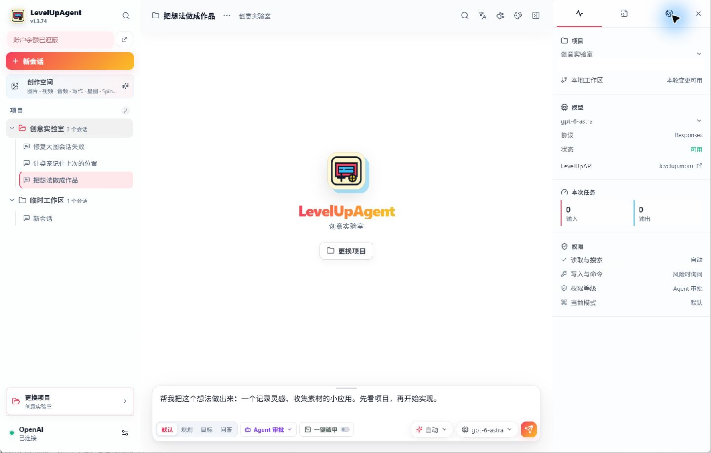

<div align="center">


# LevelUpAgent

### 把想法，做成作品。

会写代码，也懂创作的桌面 Agent。连接自己的模型，从第一句想法到最后一次交付。

[](https://github.com/TippingGame/LevelUpAgent/releases/latest) [](https://github.com/TippingGame/LevelUpAgent/releases/latest) [](LICENSE)

**[下载应用](https://github.com/TippingGame/LevelUpAgent/releases/latest)** · **[使用文档](docs/README.md)** · [反馈与建议](https://github.com/TippingGame/LevelUpAgent/issues)

**简体中文** · [English](README_EN.md)

</div>



## 一个工作区，从思考到交付

让 Agent 读项目、改代码、运行命令、验证页面；也可以先规划，再执行。长任务交给 Goal，过程中的文件、工具调用与变更都能回看。

| 想做什么 | 在这里完成 |
| --- | --- |
| **开发与研究** | 流式会话 · 项目文件 · 终端 · 浏览器验证 · 变更审阅 |
| **图片与声音** | 生图 · 参考图编辑 · 蒙版重绘 · 视频 · 语音 · 纯音乐与歌词歌曲 |
| **故事与世界** | 写作工作台 · 设定与参考库 · 剧情试玩 · Spine · 3D |
| **自己的工作方式** | Skills · MCP · 星图工作流 · 主题与布局 · 桌宠陪伴 |

## 灵感，有地方落地

写下画面，带上参考图，开始创作。提示词、参数与生成历史留在本机，下一次灵感可以接着上一次继续。


<div align="center"><sub>云端邮局 · 深海图书馆 · 月面咖啡馆 · 掌心森林 · 沙漠里的春天 · 星际花园<br />截图来自 1.3.74 独立演示工作区；账户余额已遮蔽。</sub></div>

## 三步开始

1. **安装** — 从 [Releases](https://github.com/TippingGame/LevelUpAgent/releases/latest) 下载对应系统的安装包。
2. **连接** — 填写自己的 Base URL、API Key 和模型。支持 Responses、Chat Completions、Anthropic、Gemini 与 OpenCode Go。
3. **开工** — 选择项目开始会话，或进入创作空间生成第一件作品。`Ctrl / Cmd + K` 随时搜索会话和命令。

会话与草稿保存在本机，API Key 存入系统凭据库；发送的上下文会交给所选模型服务。默认 Agent 权限允许工作区编辑和部分命令自动执行，也可切换为逐项审批。[权限与数据说明 →](docs/SECURITY_AUDIT.md)

<details>
<summary><strong>本地开发</strong></summary>

需要 Node.js 22.18+、pnpm 11+、稳定版 Rust 和 [Tauri 平台依赖](https://v2.tauri.app/start/prerequisites/)。

```sh
pnpm install --frozen-lockfile
pnpm tauri dev
```

`pnpm dev` 仅预览前端。提交前运行 `pnpm check`、`pnpm build`、`cargo test --manifest-path src-tauri/Cargo.toml`。更多见 [架构](docs/ARCHITECTURE.md) 与 [发布规范](docs/RELEASE_GUIDE.md)。

</details>

<sub>本地音乐支持 Windows x64：ACE-Step 1.5 使用 MIT／Qwen3 Apache-2.0；YuE2 INT8 支持参考旋律改编，YuE2 与 MusicGen 权重为 CC-BY-NC-4.0，仅限非商业用途。音频与 3D 大型资源按需下载。[功能与运行条件](docs/FEATURES.md) · [1.3.77 更新说明及平台签名情况](docs/RELEASE_1.3.77.md)</sub>

---

[LGPL-3.0-only](LICENSE) · [第三方归属](src-tauri/THIRD_PARTY_NOTICES.md) · [LevelUpAPI](https://levelup.mom/)
